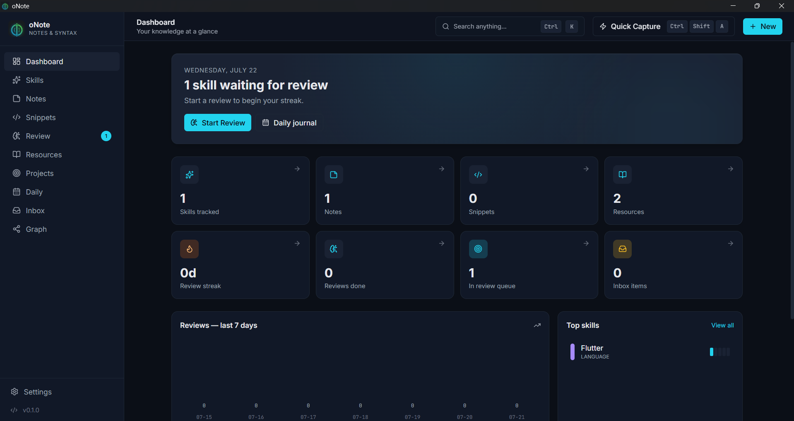
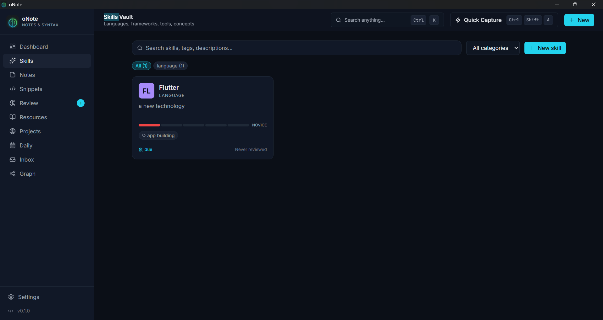
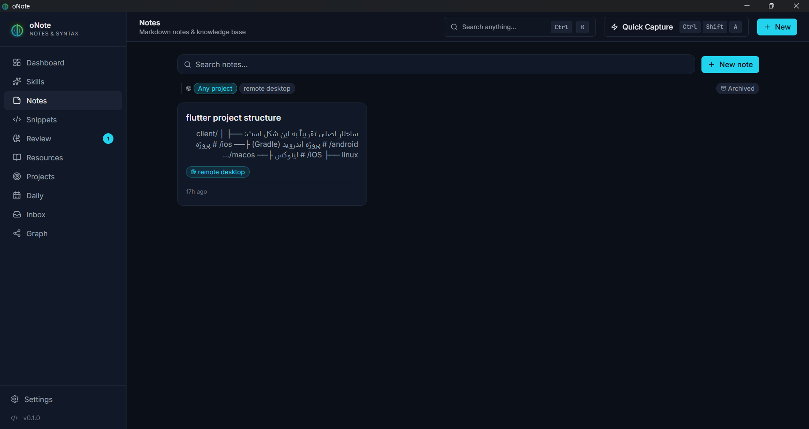
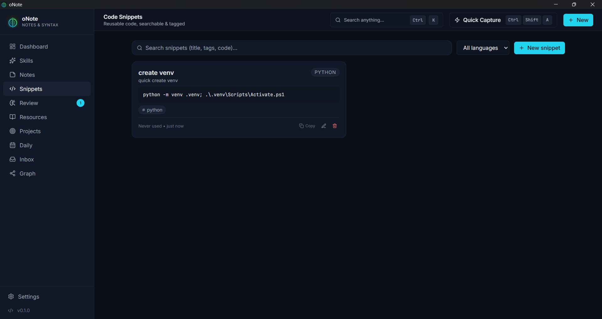
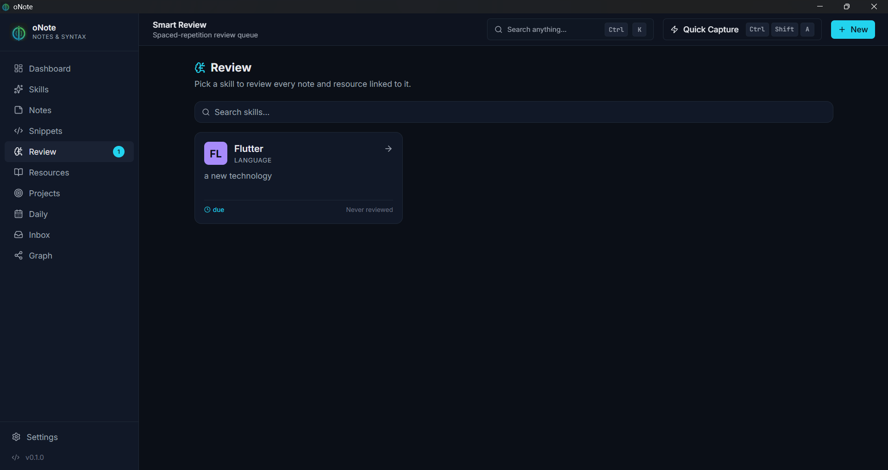
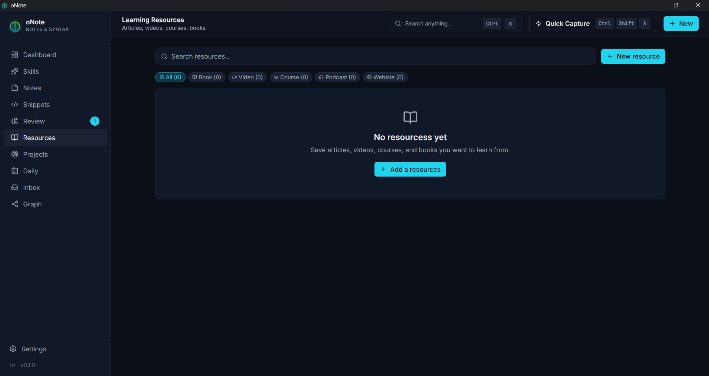
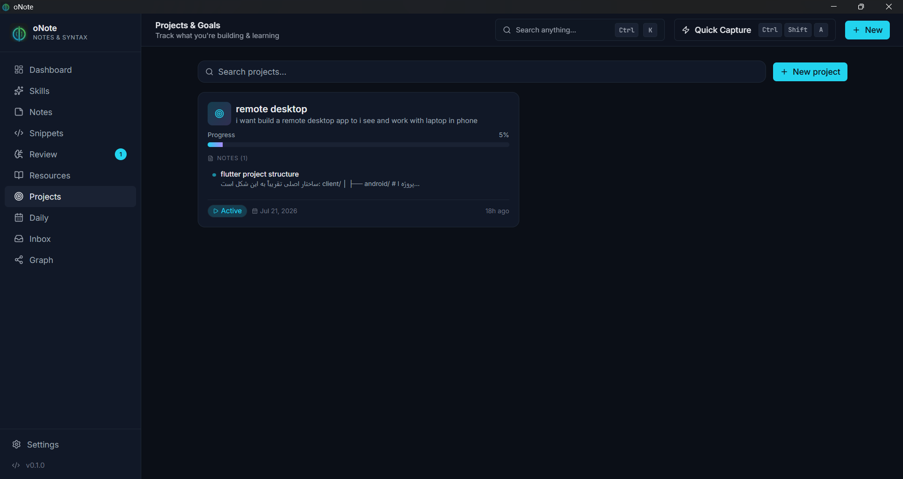
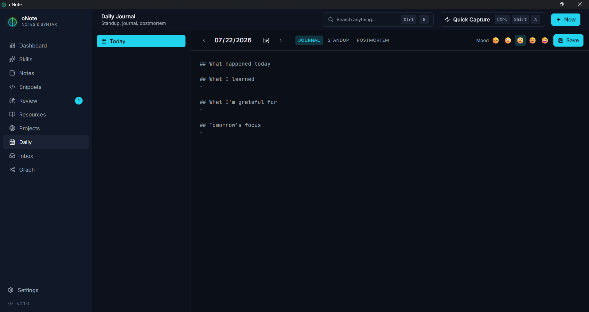
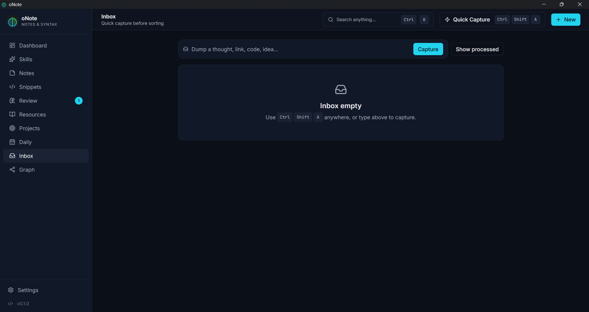
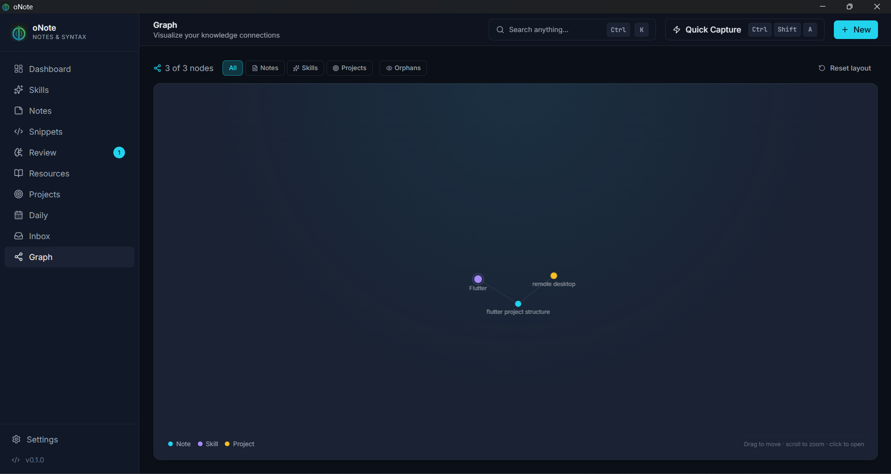

# 🧠 oNote

> **A knowledge vault for programmers** — track skills, capture notes, store snippets, and review what you learn with built-in spaced repetition.
>
> **یه knowledge vault برای برنامه‌نویس‌ها** — مهارت‌ها، یادداشت‌ها، snippetها و review، همه توی یه جا.

<div align="center">


-34d399?style=flat-square)


</div>

---

## Screenshots

| Dashboard | Skills |
|------|-------|
|  |  |

| Notes | Snippets |
|------|-------|
|  |  |

| Review | Resources |
|------|-------|
|  |  |

| Projects | Daily |
|------|-------|
|  |  |

| Inbox | Graph |
|------|-------|
|  |  |

---

## 📥 Download / دانلود

> **🇬🇧 Pre-built binaries live in [Releases](../../releases) for every platform we support. No build tools required — just download, install, run.**
>
> **🇮🇷 نسخه‌های آماده برای تمام پلتفرم‌هایی که ساپورت می‌کنیم توی [Releases](../../releases) هست. نیازی به build کردن نیست — فقط دانلود، نصب، اجرا.**

<div align="center">

| Platform | Installer | Portable | Notes |
| -------- | --------- | -------- | ----- |
| 🪟 **Windows (x64)** | `.msi` / `.exe` (NSIS) | `.exe` standalone | WebView2 required (pre-installed on Win10/11) |
| 🐧 **Linux (x64)** | `.deb` / `.rpm` | `.AppImage` | `webkit2gtk-4.1` runtime |
| 🍎 **macOS** | `.dmg` (planned) | — | Not built in CI yet — see [Build from source](#build-from-source--ساخت-از-سورس) |

</div>

> ℹ️ **Pre-releases are tagged `v0.2.0-rcN` and may be unstable.** Check the release notes before installing.
>
> **پیش‌نسخه‌ها با تگ `v0.2.0-rcN` مشخص می‌شن و ممکنه ناپایدار باشن.** قبل از نصب، release notes رو چک کن.

---

## 🇬🇧 English

### What is oNote?

A **cross-platform desktop app** built for developers, security engineers, DevOps, and AI engineers. Your data **stays on your machine** (local SQLite) — no cloud, no telemetry, no accounts.

Instead of juggling ten different tools (Notion + Anki + GitHub Gist + Todoist + …), oNote puts them all in one place:

| Feature             | What it does                                                          |
| ------------------- | --------------------------------------------------------------------- |
| 🧩 **Skills Vault** | Track languages, frameworks, tools, and concepts with a 1–5 level     |
| 📝 **Notes**        | Markdown notes with syntax highlighting, tags, and backlinks          |
| 💻 **Snippets**     | Searchable code library with language & topic tags                    |
| 🧠 **Smart Review** | Spaced-repetition review queue (SM-2 algorithm)                       |
| 📚 **Resources**    | Articles, videos, courses — with status (to-read / in-progress / done)|
| 🎯 **Projects**     | Track what you're building and learning                               |
| 📅 **Daily**        | Daily journal, standup, postmortem                                    |
| 📥 **Inbox**        | Quick capture, sort it later                                          |
| 🕸️ **Graph**        | Visual map of how your knowledge connects                             |
| 🏆 **Achievements** | Light gamification to keep you consistent                             |

### Quick start

**Prerequisites**

- **Node.js ≥ 18**
- **Rust ≥ 1.77** (install via [rustup](https://rustup.rs))
- **Windows**: Visual Studio Build Tools with the "Desktop development with C++" workload
- **Linux**: `libwebkit2gtk-4.1-dev` and a few more deps (full list in [`devnotes/README.md`](./devnotes/README.md))

**Run in dev**

```bash
git clone https://github.com/USER/REPO.git onote
cd onote/devnotes
npm install
npm run tauri:dev
```

> ⚠️ The first `tauri:dev` run takes 5–10 min — it compiles ~570 Rust crates. After that, hot reload is fast.

**Build from source**

```bash
cd devnotes
npm run tauri:build
```

Outputs land in `devnotes/src-tauri/target/release/bundle/`:

- 🪟 **Windows**: `.msi` (WiX) or `.exe` (NSIS), plus a portable `devnotes.exe`
- 🐧 **Linux**: `.deb`, `.AppImage`, or `.rpm`

Full build, cross-compile, and troubleshooting instructions in [`devnotes/README.md`](./devnotes/README.md).

### Stack

| Layer        | Tech                                                |
| ------------ | --------------------------------------------------- |
| Shell        | Tauri 2 (Rust)                                      |
| Frontend     | React 18 + TypeScript + Vite                        |
| Styling      | TailwindCSS                                         |
| State (UI)   | Zustand                                             |
| Database     | SQLite via `sqlx`                                   |
| Markdown     | `react-markdown` + `remark-gfm` + `rehype-highlight`|
| Plugins      | sql, store, dialog, fs, notification, global-shortcut |

### Keyboard shortcuts

| Action                       | Shortcut                       |
| ---------------------------- | ------------------------------ |
| 🎯 Command Palette            | `Ctrl`/`Cmd` + `K`             |
| ⚡ Quick Capture (in app)      | `Ctrl`/`Cmd` + `Shift` + `A`   |
| ⚡ Quick Capture (global)      | `Ctrl`/`Cmd` + `Shift` + `Space` |
| 🔍 Focus search               | `Ctrl`/`Cmd` + `/`             |

### Project structure

```
minimax test/                # repo root
├── README.md                # ← this file (GitHub landing)
├── devnotes/                # main app code
│   ├── src/                 # React + TS frontend
│   │   ├── components/      # Sidebar, Topbar, CommandPalette, ...
│   │   ├── pages/           # Dashboard, Skills, Notes, Review, ...
│   │   ├── store/           # Zustand store
│   │   └── lib/             # API wrappers, utils
│   ├── src-tauri/           # Rust backend + Tauri config
│   ├── package.json
│   └── README.md            # detailed dev/build guide
└── devnotes/                # dev notes
```

### Data location

oNote stores everything in a local SQLite file:

| OS       | Path                                          |
| -------- | --------------------------------------------- |
| 🪟 Windows | `%APPDATA%\com.onote.notes\onote.db`          |
| 🐧 Linux   | `~/.local/share/com.onote.notes/onote.db`     |

To back up: copy that file, or use **Settings → Export all (JSON)** in-app.

### Roadmap

- [x] Skills vault + spaced repetition
- [x] Markdown notes with syntax highlighting
- [x] Snippet library with tags
- [x] Smart review queue
- [x] Global quick-capture hotkey
- [ ] Full graph view (partial today)
- [ ] Optional end-to-end encrypted sync
- [ ] Mobile companion (PWA)
- [ ] Markdown / PDF export
- [ ] Plugin system for themes and workflows

### Contributing

PRs welcome! 🎉

1. Fork it
2. Create your feature branch (`git checkout -b feat/amazing-thing`)
3. Commit your changes (`git commit -m 'feat: add amazing thing'`)
4. Push to the branch (`git push origin feat/amazing-thing`)
5. Open a Pull Request

For bigger changes, please open an issue first so we can discuss.

### License

[MIT](./LICENSE) © 2025 oNote contributors

### Acknowledgments

Built with ☕ and a lot of headaches. Inspired by:
- [Obsidian](https://obsidian.md/) (linked vault)
- [Anki](https://apps.ankiweb.net/) (spaced repetition)
- [Notion](https://notion.so/) (block-based editing)
- and a whole graveyard of physical notebooks

---

## 🇮🇷 فارسی

### oNote چیه؟

یه اپلیکیشن دسکتاپ **cross-platform** که برای developerها، security engineerها، DevOps و AI engineerها ساخته شده. داده‌هات **روی سیستم خودت** می‌مونه (SQLite لوکال) — هیچ cloud، هیچ telemetry، هیچ account.

به جای اینکه ۱۰ تا ابزار مختلف داشته باشی (Notion + Anki + GitHub Gist + Todoist + ...)، oNote همه‌شون رو توی یه جا جمع کرده:

| قابلیت              | چی کار می‌کنه                                                          |
| ------------------- | --------------------------------------------------------------------- |
| 🧩 **Skills Vault** | زبان‌ها، فریم‌ورک‌ها، ابزارها و conceptها رو با level 1-5 ثبت کن        |
| 📝 **Notes**        | یادداشت‌های Markdown با syntax highlighting، tag و backlink            |
| 💻 **Snippets**     | کتابخانه کد قابل سرچ با tag زبان و موضوع                              |
| 🧠 **Smart Review** | صف مرور با spaced repetition (الگوریتم SM-2)                           |
| 📚 **Resources**    | لینک مقاله، ویدیو، دوره — با status (to-read / in-progress / done)     |
| 🎯 **Projects**     | پروژه‌ها و goalهای یادگیری                                             |
| 📅 **Daily**        | ژورنال روزانه، standup، postmortem                                    |
| 📥 **Inbox**        | capture سریع، بعداً sort می‌کنی                                        |
| 🕸️ **Graph**        | visualization گرافیکی از ارتباطات بین دانسته‌ها                        |
| 🏆 **Achievements** | gamification ملایم برای consistency                                    |

### شروع سریع

**پیش‌نیازها**

- **Node.js ≥ 18**
- **Rust ≥ 1.77** (از [rustup](https://rustup.rs) نصب کن)
- **Windows**: Visual Studio Build Tools با workload «Desktop development with C++»
- **Linux**: `libwebkit2gtk-4.1-dev` و چندتا dependency دیگه (جزئیات در `devnotes/README.md`)

**اجرا در dev**

```bash
git clone https://github.com/USER/REPO.git onote
cd onote/devnotes
npm install
npm run tauri:dev
```

> ⚠️ اولین اجرای `tauri:dev` حدود ۵-۱۰ دقیقه طول می‌کشه چون ~۵۷۰ crate Rust رو کامپایل می‌کنه. بعدش hot reload سریع می‌شه.

**ساخت از سورس**

```bash
cd devnotes
npm run tauri:build
```

خروجی در `devnotes/src-tauri/target/release/bundle/`:

- 🪟 **Windows**: `.msi` (WiX) یا `.exe` (NSIS)، به‌علاوه `devnotes.exe` پرتابل
- 🐧 **Linux**: `.deb`، `.AppImage` یا `.rpm`

جزئیات کامل build، cross-compile و troubleshooting در [`devnotes/README.md`](./devnotes/README.md).

### پشته تکنولوژی

| لایه           | تکنولوژی                                                |
| -------------- | ------------------------------------------------------- |
| Shell          | Tauri 2 (Rust)                                          |
| Frontend       | React 18 + TypeScript + Vite                            |
| استایل         | TailwindCSS                                             |
| State (UI)     | Zustand                                                 |
| Database       | SQLite (از طریق `sqlx`)                                 |
| Markdown       | `react-markdown` + `remark-gfm` + `rehype-highlight`    |
| Pluginها       | sql, store, dialog, fs, notification, global-shortcut  |

### شورت‌کات‌های کیبورد

| عملکرد                       | شورت‌کات                       |
| ---------------------------- | ----------------------------- |
| 🎯 Command Palette            | `Ctrl`/`Cmd` + `K`            |
| ⚡ Quick Capture (توی اپ)      | `Ctrl`/`Cmd` + `Shift` + `A`  |
| ⚡ Quick Capture (سراسری)      | `Ctrl`/`Cmd` + `Shift` + `Space` |
| 🔍 فوکوس روی search          | `Ctrl`/`Cmd` + `/`            |

### ساختار پروژه

```
minimax test/                # ریشه ریپو
├── README.md                # ← این فایل (GitHub landing)
├── devnotes/                # کد اصلی اپ
│   ├── src/                 # React + TS frontend
│   │   ├── components/      # Sidebar, Topbar, CommandPalette, ...
│   │   ├── pages/           # Dashboard, Skills, Notes, Review, ...
│   │   ├── store/           # Zustand store
│   │   └── lib/             # API wrappers, utils
│   ├── src-tauri/           # Rust backend + Tauri config
│   ├── package.json
│   └── README.md            # راهنمای کامل dev/build
└── devnotes/                # یادداشت‌های توسعه
```

### محل ذخیره داده

oNote همه‌چیز رو توی SQLite محلی نگه می‌داره:

| سیستم‌عامل | مسیر                                          |
| ---------- | --------------------------------------------- |
| 🪟 Windows | `%APPDATA%\com.onote.notes\onote.db`          |
| 🐧 Linux   | `~/.local/share/com.onote.notes/onote.db`     |

بکاپ: همون فایل رو کپی کن، یا از داخل اپ **Settings → Export all (JSON)** بزن.

### نقشه راه

- [x] Skills vault + spaced repetition
- [x] Markdown notes با syntax highlighting
- [x] Snippet library با tag
- [x] Smart review queue
- [x] Quick capture سراسری (global hotkey)
- [ ] Graph view کامل (partial هست)
- [ ] همگام‌سازی اختیاری (end-to-end encrypted)
- [ ] Mobile companion (PWA)
- [ ] Markdown / PDF export
- [ ] Plugin system برای تم‌ها و workflowها

### مشارکت

PRها خوش‌اومد می‌گن! 🎉

1. Fork کن
2. Branch feature بساز (`git checkout -b feat/amazing-thing`)
3. Commit کن (`git commit -m 'feat: add amazing thing'`)
4. Push کن (`git push origin feat/amazing-thing`)
5. یه PR باز کن

لطفاً قبلش برای تغییرات بزرگ یه issue باز کنید که در موردش بحث کنیم.

### لایسنس

[MIT](./LICENSE) © 2025 oNote contributors

### قدردانی

ساخته‌شده با ☕ و کلی سردرد. الهام گرفته از:
- [Obsidian](https://obsidian.md/) (vault لینک‌شده)
- [Anki](https://apps.ankiweb.net/) (spaced repetition)
- [Notion](https://notion.so/) (block-based editing)
- و یه عالمه notebook فیزیکی که هیچ‌وقت پر نشد

---

<div align="center">

**[⬆ back to top / برگشت به بالا](#-onote)**

</div>
